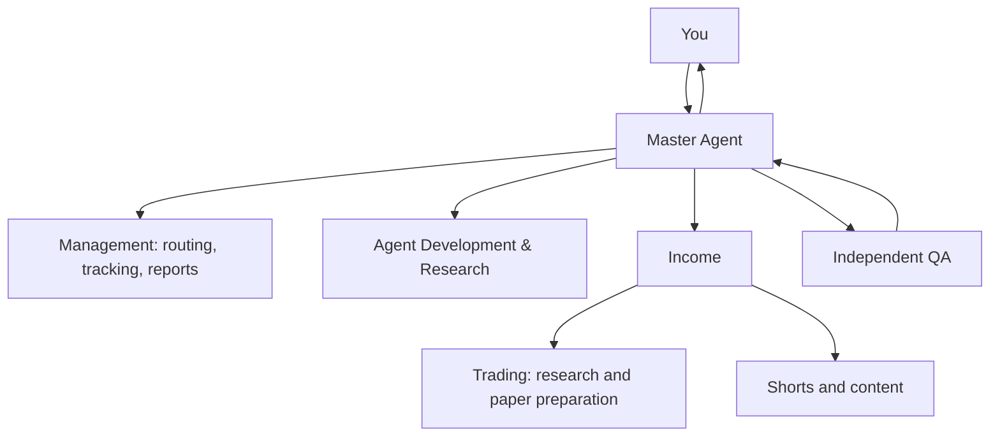

# Master Agent System

A supervised Claude Code master agent that receives your requests, delegates to
department leads or a specific worker, and returns reviewed reports.



Agent Development & Research designs agents, reviews skills, checks documentation
and proposes tested updates. Income coordinates the imported opportunity framework,
Trading and Shorts. The master invokes department specialists through Claude Code's
native Agent tool. Project-local profiles are in `.claude/agents/`.

This is version 0.2: working local task management and prepared agent definitions.
Actual AI delegation needs a signed-in Claude Code session. There is no unattended
scheduler, authenticated approval service, live broker connector or auto-publishing.

## Start in Claude Code

Requires Python 3.10+, Node.js and your own authorized Claude Code access.
The official CLI is pinned in `tools/claude/package-lock.json`.

```bash
cd master-agent-system
npm ci --prefix tools/claude --no-audit --no-fund
tools/claude/node_modules/.bin/claude auth login
bash scripts/start-master.sh
```

Authenticate using the official CLI flow; never paste keys into chat or commit
them. Network policy must permit the authentication/API destinations required by
your chosen Claude account. This environment currently has package-manager access;
Claude API/auth access has not been verified. Do not bypass the proxy or TLS checks.
Keep the runtime's normal permission prompts enabled.

Suggested first request:

> Act as my master agent. Ask Agent Development & Research to inspect our current
> roles and skills and report missing capabilities with dated evidence. Ask Income
> to prepare a research-only trading intake checklist. Use separate child tasks,
> independent QA, and return one consolidated report. Do not place orders or
> configure a real trading account.

## Local task hub

The hub needs only Python's standard library; no API keys or pip installation.

```bash
python -m agent_hub agents
python -m agent_hub new 'Inspect trading prerequisites' \
  --department trading --mode paper \
  --criteria 'List missing account inputs, data sources and paper-test requirements'
python -m agent_hub dispatch 1
python -m agent_hub show 1
python -m agent_hub report
python -m agent_hub report --format markdown
```

`dispatch` produces a handoff packet; it does **not** call a model. Have Claude Code
invoke the packet's named agent with its instructions. Explicit departments are
`management`, `agent-development`, `income`, `trading`, `shorts`, `quality`.
`--agent NAME` selects a specific root profile; `--parent ID` links child work.
No request is routed by a guessed keyword.

Each dispatched task requires a preflight record before result submission. Read the
current instructions and selected skills, check the available runtime and assess
whether the task needs current external evidence. Copy `templates/preflight.json`,
replace its fingerprint with the packet value, and fill in the checks actually done:

```bash
python -m agent_hub preflight 1 --checks work/task-1-preflight.json
```

VERIFIED freshness requires dated source records; UNVERIFIED must be disclosed in
the result's limitations. NOT_REQUIRED is for tasks without changing external claims.
The hub validates records; it cannot prove the agent read a document or visited a URL.

After actual execution, create a result JSON with `summary`, nonempty `artifacts`
(existing repository-relative paths), `sources` (location, timezone-aware checked_at,
classification VERIFIED/ASSUMPTION/HISTORICAL) and `limitations`. Then:

```bash
python -m agent_hub submit 1 --result outputs/task-1-result.json
# Only after a genuinely independent QA invocation:
python -m agent_hub review 1 --reviewer qa-auditor --verdict PASS \
  --notes 'Describe checks actually performed and their evidence'
```

Statuses: QUEUED -> DISPATCHED -> QA -> COMPLETED; QA may request REWORK or BLOCKED.
Three rework verdicts block the task. A parent cannot pass until every child is
complete. Changed instructions require cancellation and a new packet; changed
artifacts require rework and resubmission. Use `cancel ID --reason '...'`.
Parent PASS recursively rechecks the instruction and artifact hashes of completed
children. Fresh preflight checks are required after each rework dispatch.
Blocked tasks can be replaced with new tasks citing the original ID; old records
remain available. Cancellation does not cancel child tasks automatically.

SQLite state is created in ignored `data/`. Reports expose the actual recorded
state, not assumed completion. QA records are trusted operator attestations and
do not authenticate who reviewed. Shell-capable AI agents are not isolated by
the database. This is a single-user supervised tool, not a multiuser service.

## Packages and validation

`vendor/maos`, `vendor/income`, `vendor/shorts` and `vendor/day-trader` preserve the
uploaded source packages, including hidden definitions, skills, tests and license
files where supplied. Root instructions govern integration; nested project
instructions are used only by their selected department. The 11 trader skill
links in `.claude/skills/` preserve relative tool paths. Other vendor skills are
read by department leads as needed. Native skills are not assumed loaded simply
because a file exists in vendor/.

```bash
python -m unittest discover -s tests -v
python scripts/validate_all.py
```

Read [the recheck](docs/READINESS-RECHECK.md), [agent lifecycle](docs/AGENT-LIFECYCLE.md)
and [trading boundaries](docs/TRADING.md). Imported tools keep their own separate
databases; the root hub tracks cross-department tasks, not automatic database sync.

Live trading remains disabled. Example balances and limits are not your settings.
No profit, live-data freshness or external integration is established by fixture tests.

For the first real session, use [START-HERE.md](START-HERE.md). No Claude Code
authentication is bundled; it must be completed in your own runtime.
