# Complete architecture and agent hierarchy

All 42 selectable root profiles are shown below. Vendor definitions remain preserved references.

```mermaid
flowchart TD
  USER[User] --> master_agent[Master Agent]
  management_director --> agent_creator_researcher["agent-creator-researcher"]
  management_director --> income_director["income-director"]
  income_director --> trading_director["trading-director"]
  income_director --> shorts_director["shorts-director"]
  master_agent --> qa_auditor["qa-auditor"]
  management_director --> agent_runner["agent-runner"]
  management_director --> task_router["task-router"]
  agent_creator_researcher --> agent_creator["agent-creator"]
  management_director --> token_watchdog["token-watchdog"]
  management_director --> research_analyst["research-analyst"]
  management_director --> rework_specialist["rework-specialist"]
  management_director --> registry_manager["registry-manager"]
  management_director --> learning_analyst["learning-analyst"]
  management_director --> reporting_specialist["reporting-specialist"]
  income_director --> ioi_reporting_learning_agent["ioi-reporting-learning-agent"]
  income_director --> ioi_creative_opportunity_generator["ioi-creative-opportunity-generator"]
  income_director --> ioi_rework_improvement_agent["ioi-rework-improvement-agent"]
  income_director --> ioi_experiment_validation_agent["ioi-experiment-validation-agent"]
  income_director --> ioi_data_profitability_analyst["ioi-data-profitability-analyst"]
  income_director --> ioi_business_execution_planner["ioi-business-execution-planner"]
  income_director --> ioi_quality_fraud_auditor["ioi-quality-fraud-auditor"]
  income_director --> ioi_market_competitor_analyst["ioi-market-competitor-analyst"]
  income_director --> ioi_global_opportunity_researcher["ioi-global-opportunity-researcher"]
  income_director --> ioi_continuous_monitoring_agent["ioi-continuous-monitoring-agent"]
  income_director --> ioi_iraq_feasibility_researcher["ioi-iraq-feasibility-researcher"]
  shorts_director --> shorts_quality_check_compliance["shorts-quality-check-compliance"]
  shorts_director --> shorts_analytics_optimization["shorts-analytics-optimization"]
  shorts_director --> shorts_visual_video_producer["shorts-visual-video-producer"]
  shorts_director --> shorts_scriptwriter_storyteller["shorts-scriptwriter-storyteller"]
  shorts_director --> shorts_content_strategist["shorts-content-strategist"]
  shorts_director --> shorts_competitor_intelligence_analyst["shorts-competitor-intelligence-analyst"]
  shorts_director --> shorts_niche_market_researcher["shorts-niche-market-researcher"]
  master_agent --> management_director["management-director"]
  income_director --> iraq_ecommerce_director["iraq-ecommerce-director"]
  iraq_ecommerce_director --> iraq_market_researcher["iraq-market-researcher"]
  iraq_ecommerce_director --> product_opportunity_researcher["product-opportunity-researcher"]
  iraq_ecommerce_director --> supplier_dropshipping_researcher["supplier-dropshipping-researcher"]
  iraq_ecommerce_director --> logistics_fulfillment_analyst["logistics-fulfillment-analyst"]
  iraq_ecommerce_director --> ecommerce_finance_payments_analyst["ecommerce-finance-payments-analyst"]
  iraq_ecommerce_director --> ecommerce_marketing_strategist["ecommerce-marketing-strategist"]
  iraq_ecommerce_director --> ecommerce_business_validation_analyst["ecommerce-business-validation-analyst"]
  qa_auditor -->|Reviewed report| master_agent
  management_director -->|Research/plan/rework records| VAULT[(Local SQLite Memory Vault)]
  VAULT -->|Recall evidence| management_director
  VAULT -->|Incremental guarded projection| MD[Local Markdown vault]
  VAULT -. Future adapter; unconfigured .-> NOTION[Notion stub]
  agent_creator_researcher --> REG[Central Skill Registry]
  REG --> FINDER[Discovery-only Skill Finder adapter]
  qa_auditor -->|REWORK corrections| management_director
```

## Agent registry

| Agent | Department | Reports to |
| --- | --- | --- |
| master-agent | management | User |
| agent-creator-researcher | agent-development | management-director |
| income-director | income | management-director |
| trading-director | trading | income-director |
| shorts-director | shorts | income-director |
| qa-auditor | quality | master-agent |
| agent-runner | management | management-director |
| task-router | management | management-director |
| agent-creator | agent-development | agent-creator-researcher |
| token-watchdog | management | management-director |
| research-analyst | management | management-director |
| rework-specialist | management | management-director |
| registry-manager | management | management-director |
| learning-analyst | management | management-director |
| reporting-specialist | management | management-director |
| ioi-reporting-learning-agent | income | income-director |
| ioi-creative-opportunity-generator | income | income-director |
| ioi-rework-improvement-agent | income | income-director |
| ioi-experiment-validation-agent | income | income-director |
| ioi-data-profitability-analyst | income | income-director |
| ioi-business-execution-planner | income | income-director |
| ioi-quality-fraud-auditor | income | income-director |
| ioi-market-competitor-analyst | income | income-director |
| ioi-global-opportunity-researcher | income | income-director |
| ioi-continuous-monitoring-agent | income | income-director |
| ioi-iraq-feasibility-researcher | income | income-director |
| shorts-quality-check-compliance | shorts | shorts-director |
| shorts-analytics-optimization | shorts | shorts-director |
| shorts-visual-video-producer | shorts | shorts-director |
| shorts-scriptwriter-storyteller | shorts | shorts-director |
| shorts-content-strategist | shorts | shorts-director |
| shorts-competitor-intelligence-analyst | shorts | shorts-director |
| shorts-niche-market-researcher | shorts | shorts-director |
| management-director | management | master-agent |
| iraq-ecommerce-director | ecommerce | income-director |
| iraq-market-researcher | ecommerce | iraq-ecommerce-director |
| product-opportunity-researcher | ecommerce | iraq-ecommerce-director |
| supplier-dropshipping-researcher | ecommerce | iraq-ecommerce-director |
| logistics-fulfillment-analyst | ecommerce | iraq-ecommerce-director |
| ecommerce-finance-payments-analyst | ecommerce | iraq-ecommerce-director |
| ecommerce-marketing-strategist | ecommerce | iraq-ecommerce-director |
| ecommerce-business-validation-analyst | ecommerce | iraq-ecommerce-director |

Management controls the logical work chain. Native workers need not spawn other
workers: the master can perform each actual invocation while keeping department
ownership and QA independence visible. Research/Trading/Shorts/E-commerce outputs
are evidence-bearing artifacts; the local database does not perform the specialist
reasoning or call external services. The QA rework state machine is in WORKFLOW-V03.md.
