# Architecture and full role registry — v0.5

70 root roles. Web and Social are independent departments under Management.

```mermaid
flowchart TD
  USER[User] --> master_agent[Master Agent]
  management_director --> agent_creator_researcher["agent-creator-researcher"]
  management_director --> income_director["income-director"]
  income_director --> trading_director["trading-director"]
  income_director --> shorts_director["shorts-director"]
  master_agent --> qa_auditor["qa-auditor"]
  management_director --> agent_runner["agent-runner"]
  management_director --> task_router["task-router"]
  agent_creator_researcher --> agent_creator["agent-creator"]
  management_director --> token_watchdog["token-watchdog"]
  management_director --> research_analyst["research-analyst"]
  management_director --> rework_specialist["rework-specialist"]
  management_director --> registry_manager["registry-manager"]
  management_director --> learning_analyst["learning-analyst"]
  management_director --> reporting_specialist["reporting-specialist"]
  income_director --> ioi_reporting_learning_agent["ioi-reporting-learning-agent"]
  income_director --> ioi_creative_opportunity_generator["ioi-creative-opportunity-generator"]
  income_director --> ioi_rework_improvement_agent["ioi-rework-improvement-agent"]
  income_director --> ioi_experiment_validation_agent["ioi-experiment-validation-agent"]
  income_director --> ioi_data_profitability_analyst["ioi-data-profitability-analyst"]
  income_director --> ioi_business_execution_planner["ioi-business-execution-planner"]
  income_director --> ioi_quality_fraud_auditor["ioi-quality-fraud-auditor"]
  income_director --> ioi_market_competitor_analyst["ioi-market-competitor-analyst"]
  income_director --> ioi_global_opportunity_researcher["ioi-global-opportunity-researcher"]
  income_director --> ioi_continuous_monitoring_agent["ioi-continuous-monitoring-agent"]
  income_director --> ioi_iraq_feasibility_researcher["ioi-iraq-feasibility-researcher"]
  shorts_director --> shorts_quality_check_compliance["shorts-quality-check-compliance"]
  shorts_director --> shorts_analytics_optimization["shorts-analytics-optimization"]
  shorts_director --> shorts_visual_video_producer["shorts-visual-video-producer"]
  shorts_director --> shorts_scriptwriter_storyteller["shorts-scriptwriter-storyteller"]
  shorts_director --> shorts_content_strategist["shorts-content-strategist"]
  shorts_director --> shorts_competitor_intelligence_analyst["shorts-competitor-intelligence-analyst"]
  shorts_director --> shorts_niche_market_researcher["shorts-niche-market-researcher"]
  master_agent --> management_director["management-director"]
  income_director --> iraq_ecommerce_director["iraq-ecommerce-director"]
  iraq_ecommerce_director --> iraq_market_researcher["iraq-market-researcher"]
  iraq_ecommerce_director --> product_opportunity_researcher["product-opportunity-researcher"]
  iraq_ecommerce_director --> supplier_dropshipping_researcher["supplier-dropshipping-researcher"]
  iraq_ecommerce_director --> logistics_fulfillment_analyst["logistics-fulfillment-analyst"]
  iraq_ecommerce_director --> ecommerce_finance_payments_analyst["ecommerce-finance-payments-analyst"]
  iraq_ecommerce_director --> ecommerce_marketing_strategist["ecommerce-marketing-strategist"]
  iraq_ecommerce_director --> ecommerce_business_validation_analyst["ecommerce-business-validation-analyst"]
  agent_creator_researcher --> department_health_auditor["department-health-auditor"]
  agent_creator_researcher --> knowledge_freshness_auditor["knowledge-freshness-auditor"]
  management_director --> web_application_director["web-application-director"]
  web_application_director --> web_technology_researcher["web-technology-researcher"]
  web_application_director --> web_ui_ux_researcher["web-ui-ux-researcher"]
  web_application_director --> web_product_ux_architect["web-product-ux-architect"]
  web_application_director --> web_design_system_specialist["web-design-system-specialist"]
  web_application_director --> web_frontend_engineer["web-frontend-engineer"]
  web_application_director --> web_backend_api_engineer["web-backend-api-engineer"]
  web_application_director --> web_database_architect["web-database-architect"]
  web_application_director --> web_mobile_specialist["web-mobile-specialist"]
  web_application_director --> web_testing_accessibility_engineer["web-testing-accessibility-engineer"]
  web_application_director --> web_security_performance_engineer["web-security-performance-engineer"]
  web_application_director --> web_devops_deployment_engineer["web-devops-deployment-engineer"]
  web_application_director --> web_documentation_maintenance_specialist["web-documentation-maintenance-specialist"]
  management_director --> social_media_director["social-media-director"]
  social_media_director --> social_trends_researcher["social-trends-researcher"]
  social_media_director --> social_audience_competitor_analyst["social-audience-competitor-analyst"]
  social_media_director --> social_content_strategist["social-content-strategist"]
  social_media_director --> social_copywriter_scriptwriter["social-copywriter-scriptwriter"]
  social_media_director --> social_creative_brand_designer["social-creative-brand-designer"]
  social_media_director --> social_graphic_carousel_specialist["social-graphic-carousel-specialist"]
  social_media_director --> social_video_motion_specialist["social-video-motion-specialist"]
  social_media_director --> social_calendar_scheduling_specialist["social-calendar-scheduling-specialist"]
  social_media_director --> social_analytics_specialist["social-analytics-specialist"]
  social_media_director --> social_community_reputation_specialist["social-community-reputation-specialist"]
  social_media_director --> social_platform_integration_specialist["social-platform-integration-specialist"]
  social_media_director --> social_compliance_content_reviewer["social-compliance-content-reviewer"]
  qa_auditor -->|Reviewed outcome| master_agent
  master_agent -->|Report| USER
  management_director --> VAULT[(One SQLite Vault)]
  VAULT --> DASH[Read-only dashboard]
  VAULT --> PROJECTS[Projects and campaigns]
  PROJECTS --> HANDOFF[Scoped child tasks and dependencies]
  HANDOFF --> qa_auditor
  VAULT --> CAP[Current runtime capability evidence]
  CAP --> AUTH[Exact scoped action authorization]
  AUTH -->|Reviewed artifacts and actual adapter| RECEIPT[Verified or unresolved external receipt]
  RECEIPT --> VAULT
  agent_creator_researcher --> CURATE[Quarantined source and scoped skills]
  CURATE --> qa_auditor
  VAULT --> SCHED[Optional local maintenance; disabled default]
```

| Agent | Department | Reports to |
| --- | --- | --- |
| master-agent | management | User |
| agent-creator-researcher | agent-development | management-director |
| income-director | income | management-director |
| trading-director | trading | income-director |
| shorts-director | shorts | income-director |
| qa-auditor | quality | master-agent |
| agent-runner | management | management-director |
| task-router | management | management-director |
| agent-creator | agent-development | agent-creator-researcher |
| token-watchdog | management | management-director |
| research-analyst | management | management-director |
| rework-specialist | management | management-director |
| registry-manager | management | management-director |
| learning-analyst | management | management-director |
| reporting-specialist | management | management-director |
| ioi-reporting-learning-agent | income | income-director |
| ioi-creative-opportunity-generator | income | income-director |
| ioi-rework-improvement-agent | income | income-director |
| ioi-experiment-validation-agent | income | income-director |
| ioi-data-profitability-analyst | income | income-director |
| ioi-business-execution-planner | income | income-director |
| ioi-quality-fraud-auditor | income | income-director |
| ioi-market-competitor-analyst | income | income-director |
| ioi-global-opportunity-researcher | income | income-director |
| ioi-continuous-monitoring-agent | income | income-director |
| ioi-iraq-feasibility-researcher | income | income-director |
| shorts-quality-check-compliance | shorts | shorts-director |
| shorts-analytics-optimization | shorts | shorts-director |
| shorts-visual-video-producer | shorts | shorts-director |
| shorts-scriptwriter-storyteller | shorts | shorts-director |
| shorts-content-strategist | shorts | shorts-director |
| shorts-competitor-intelligence-analyst | shorts | shorts-director |
| shorts-niche-market-researcher | shorts | shorts-director |
| management-director | management | master-agent |
| iraq-ecommerce-director | ecommerce | income-director |
| iraq-market-researcher | ecommerce | iraq-ecommerce-director |
| product-opportunity-researcher | ecommerce | iraq-ecommerce-director |
| supplier-dropshipping-researcher | ecommerce | iraq-ecommerce-director |
| logistics-fulfillment-analyst | ecommerce | iraq-ecommerce-director |
| ecommerce-finance-payments-analyst | ecommerce | iraq-ecommerce-director |
| ecommerce-marketing-strategist | ecommerce | iraq-ecommerce-director |
| ecommerce-business-validation-analyst | ecommerce | iraq-ecommerce-director |
| department-health-auditor | agent-development | agent-creator-researcher |
| knowledge-freshness-auditor | agent-development | agent-creator-researcher |
| web-application-director | web-development | management-director |
| web-technology-researcher | web-development | web-application-director |
| web-ui-ux-researcher | web-development | web-application-director |
| web-product-ux-architect | web-development | web-application-director |
| web-design-system-specialist | web-development | web-application-director |
| web-frontend-engineer | web-development | web-application-director |
| web-backend-api-engineer | web-development | web-application-director |
| web-database-architect | web-development | web-application-director |
| web-mobile-specialist | web-development | web-application-director |
| web-testing-accessibility-engineer | web-development | web-application-director |
| web-security-performance-engineer | web-development | web-application-director |
| web-devops-deployment-engineer | web-development | web-application-director |
| web-documentation-maintenance-specialist | web-development | web-application-director |
| social-media-director | social-media | management-director |
| social-trends-researcher | social-media | social-media-director |
| social-audience-competitor-analyst | social-media | social-media-director |
| social-content-strategist | social-media | social-media-director |
| social-copywriter-scriptwriter | social-media | social-media-director |
| social-creative-brand-designer | social-media | social-media-director |
| social-graphic-carousel-specialist | social-media | social-media-director |
| social-video-motion-specialist | social-media | social-media-director |
| social-calendar-scheduling-specialist | social-media | social-media-director |
| social-analytics-specialist | social-media | social-media-director |
| social-community-reputation-specialist | social-media | social-media-director |
| social-platform-integration-specialist | social-media | social-media-director |
| social-compliance-content-reviewer | social-media | social-media-director |

Arrows describe required responsibility/evidence paths, not proof of actual model
invocation, available accounts or enabled background services. Read DEPARTMENTS-V05.md
and CONNECTORS-V05.md. Existing v0.3/v0.4 workflow and maintenance controls remain.
