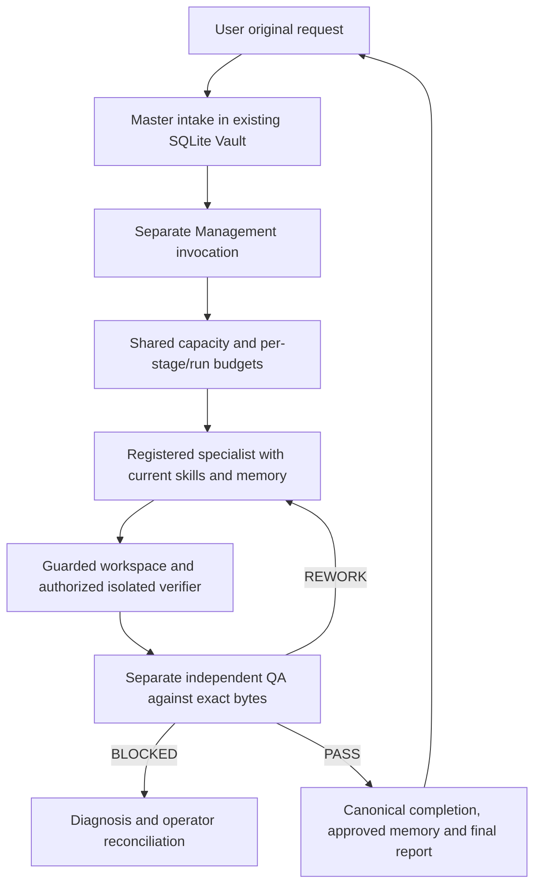

# v0.7 operation and trust boundaries

## Actual execution



Supported programmatic adapters remain Claude Code CLI, Codex CLI and OpenAI
Responses API. They need their own actual authentication and usable supported state
paths. CLI models inherit configuration unless explicitly selected. API model and
API credential environment binding are explicit. Never relocate/copy credentials,
disable guards or weaken sandboxing just to force a check to pass.

`scripts/live_model_check.py --config LOCAL_CONFIG --out work/live.json` runs a
unique harmless schema-bound task. With no config it probes the three supported
interfaces and invokes only authenticated/available ones. No automatic provider
installation or interactive login occurs. Login readiness is not inference.

`SupervisedHostAdapter` is an additional **operator-mediated** Python interface for
an already authenticated host's Agent tool. The host reads each invocation request
from an operational mailbox and invokes an actual separate agent context, then
returns an atomically published challenge-bound structured response with its actual host agent reference.
Production JSON cannot select this interface. It is not a subscription API, daemon,
credential bridge, or cryptographic proof of host identity. The operator must have
verified host access and retain genuine tool receipts. Bridge invocation UUIDs are
local coordinator IDs; upstream server model IDs, token usage and billing can be
UNKNOWN. Unattended execution requires a separately supported programmatic provider.
The recorded acceptance run used real host Agent-tool turns; mailbox fixture tests
are explicitly SIMULATED. Mailboxes contain task context and remain excluded from
Git/releases. Raw host prompts/private reasoning are not public release evidence.

## Functional acceptance

`templates/acceptance-v07.json` supplies six web and seven social profiles. Web
checks require an operator-selected template, exact reviewed verifier file hashes,
executed argv containing that verifier, original workspace-byte hash and structured
assertions with evidence. Responsive/accessibility/security/persistence assertions
have distinct kinds. A trivial exit-0 command, syntax check, stale test record or
model-written success claim cannot establish application acceptance. Operator
review of the verifier is essential: machine-readable text alone is not proof.
QA must cite actual current-byte checks and still evaluate original criteria.

Configuration fragment (fill actual reviewed hashes/references):

```json
{
  "acceptance": {
    "template": "frontend-application",
    "verifier_files": {"test-app.js": "ACTUAL_REVIEWED_SHA256"}
  },
  "checks": [{"argv": ["node", "test-app.js"], "authorization_reference": "ACTUAL_SCOPED_COMMAND_AUTHORIZATION"}]
}
```

Do not copy placeholders as approval. The task-manager fixture includes a Node
verifier and a real-browser harness. The Node DOM fixture does not prove browser
layout or WCAG compliance. Frontend acceptance remains blocked until appropriate
responsive/accessibility evidence exists. Supply a reviewed compatible browser
image; do not disable Chromium sandboxing. Docker code containers retain network
none, capability drops, non-root user and scoped project-only mount. Dependencies
are supplied in reviewed images, never silently installed by model instructions.

Social profiles require content accuracy, brand, source, licensing, platform and
authorization review. A short-video profile rejects a script-only deliverable and
requires actual media/container and reviewed current-byte media-decode, dimensions
and duration verifier assertions. Container signatures
are structural checks, not playability or copyright verification. Analytics requires
operator-supplied dataset hashes; no dataset means no fabricated reach or growth.
Carousel/brand deliverables need actual visual assets. Drafts remain drafts.

## Capacity and budgets

One claimed worker is the default across the shared Vault. The capacity gate runs
inside the SQLite writer claim transaction; concurrent connections cannot both
claim a full pool. Backpressure leaves the run QUEUED with WAITING_FOR_CAPACITY and
starts no model. It does not automatically schedule a daemon. Reinvoke `execute`
with the existing task_id/run_id once capacity is available. Live/remote worker
ownership is never stolen solely because a lease expired. Operator policy changes
are retained in runtime_policy_history.

CLI `runtime capacity --data FILE` accepts `{"limit":2,"authorization_reference":"ACTUAL_REFERENCE"}`.
Keep the smallest useful team. Existing task/project/agent/department/daily/monthly
budgets remain. Optional `run_budget_usd` persists a run ceiling; `projected_cost_usd`
is an explicit sourced estimate, not actual billing. Unknown charges/holds are not
zero. A priced event and its hold count one invocation, not two. Unknown run billing
blocks a configured run ceiling until reviewed/reconciled. Raising a ceiling does
not turn unknown cost into known cost or bypass other scoped budget gates.

`runtime set-run-budget` accepts run_id, limit_usd and authorization_reference.
Per-invocation approvals still use the existing budget approve workflow. Actual
provider receipts commit before telemetry validation: malformed/missing telemetry
creates TELEMETRY_UNRESOLVED while preserving output, provider reference and holds.

## Supervised recovery

`runtime inspect` with `{"run_id":"UUID"}` reports last saved provider receipt,
invocation errors, cost reservations, uncertain external actions and reconciliations.
`runtime recover` detects dead local workers and uncertain tools; no blind replay.
`runtime cancel` also requires reason. Cancellation cannot prove a remote charge or
external action was undone. Unconfirmed container cleanup blocks new commands.

`runtime reconcile` accepts run_id, invocation_id, outcome, reference, detail.
Outcomes: CONFIRMED_NO_RESULT, RECEIPT_RECORDED, COST_UNKNOWN. Real provider evidence
is required; text cannot fabricate a missing receipt or erase a saved one. Holds
are retained; update actual usage through the existing ledger with real evidence.

`runtime resume` accepts run_id and authorization_reference. At an IN_PROGRESS
checkpoint with a saved completed specialist receipt, the engine can apply that
receipt and proceed to QA without reinvoking the specialist. Instructions/provider
must match. Failed/uncertain provider calls are not blindly repeated.

`runtime replacement` accepts run_id, authorization_reference, diagnosis. All
uncertain provider invocations must be reconciled, pending external actions must
be reconciled through connector controls, and processes must be stopped. The
replacement task preserves original request/criteria, links the old stable run in
history and uses an idempotency key. Old receipts/holds are never discarded. Eligibility and replacement linkage share
one write transaction; the original task is cancelled with an appended event and
the old run becomes REPLACED, which cannot be resumed or claimed.

Operator references are local attestations; the trusted CLI/host must enforce
actual authorization. A role string is not authentication. Models cannot invoke
capacity, reconciliation, replacement, verifier approval or external-write controls.

## Research, connectors and dashboard

Public HTTP keeps exact host allowlists, anonymous HTTPS, public-DNS validation,
redirect checks, limits and inherited proxy/CA trust. DNS failures fail closed.
`NativeSourceAdapter` is explicit trusted-host injection for a host connector that
performs its own access/destination checks. It preserves actual reference/acquisition
metadata, bounded source bytes, publication metadata, citations, TTL and memory.
No invented DNS resolver is used. Source retrieval is PARTIALLY_VERIFIED, not
independent factual verification. Follow-ups retrieve provenance and assess TTL and
memory's verification status before reuse.

`NativeWebSearchAdapter` is a documented callback contract for authorized general
search tools. No scraping or guessed provider URL is bundled. Missing or failed
host search returns BLOCKED; GitHub repository search remains metadata search.
A ChatGPT host tool is not automatically available to a downloaded Claude Code run.

GitHub read adapter supports repository/files/commits/issues/PRs via bounded
published GET endpoints. Writes still use the existing approval and external-action
reconciliation workflow. The v0.7 release uses a dedicated branch and PR, never a
main push. See V07-READINESS-REPORT.md for exact host-read evidence and unconfigured
Figma/media/social capabilities. `operational_status` projects existing connector
records into AVAILABLE/CONNECTED/AUTHENTICATED/TESTED_READ/TESTED_WRITE/UNAVAILABLE/
FAILED/DISABLED vocabulary; simulated tests do not establish live verified operations.

The existing loopback read-only dashboard adds evidence labels, held reservations,
capacity and reconciliation records. LIVE_TESTED means an actual completed model
or host-mediated receipt, not that all task criteria passed. LOCAL_TESTED means
local checks, not a connected provider. BLOCKED/UNVERIFIED remain explicit.
