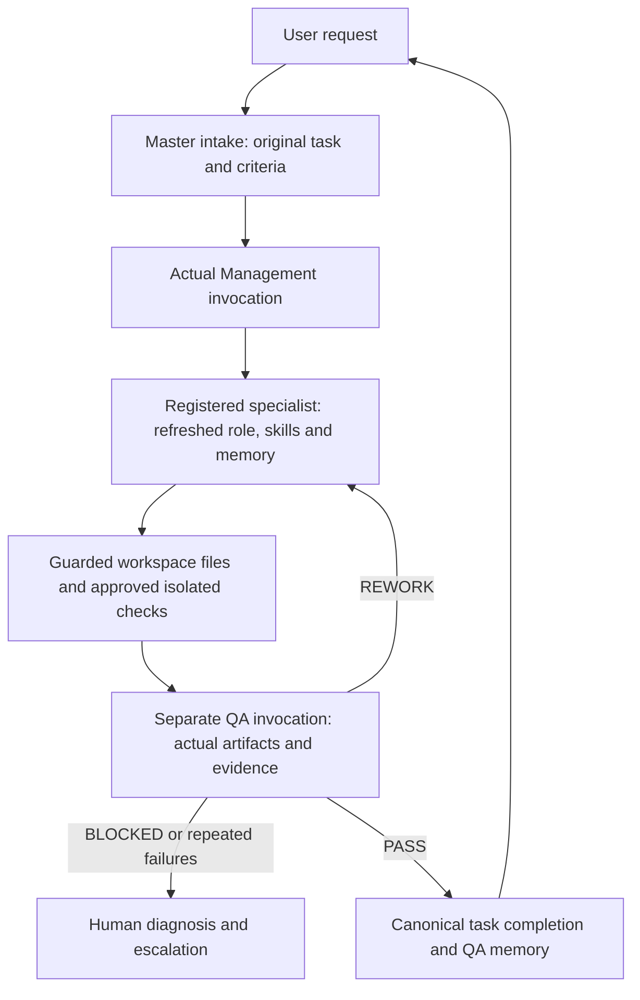

# v0.6 runtime setup and architecture

Python 3.10+ standard library. Install and authenticate the CLI using its official
supported instructions, or configure an API credential in your secure environment.
This application's interactive login does not supply a programmatic entitlement.
Never put secrets in JSON, Git, tasks, model prompts, or command arguments.

```bash
python -m agent_hub migrate
npm ci --prefix tools/claude --no-audit --no-fund
tools/claude/node_modules/.bin/claude auth login
python -m agent_hub runtime probe --config templates/runtime-claude.json
```

Probe reports readiness, **not successful inference**. Configure the installed CLI
path on Windows. See V06-PROVIDER-INTERFACES.md for supported flags and provider
contracts. Claude tools/MCP are disabled. Codex uses read-only sandboxing and
rejects enabled MCP servers; it still requires appropriate host filesystem guards.
OpenAI's Responses adapter supports only the bound read/write-workspace, research
and approved-check gateway, with no account-write operations.

Create local JSON `work/request.json`:

```json
{"request":"Write an original three-caption campaign draft and calendar as files; do not publish","criteria":"Three original captions, dated calendar with audience timezone, explicit research limitations"}
```

```bash
python -m agent_hub runtime intake --data work/request.json
```

The result contains the task ID. Create `work/execute.json` with
`{"task_id": 1}` (use the actual returned ID), then:

```bash
python -m agent_hub runtime execute --config templates/runtime-claude.json --data work/execute.json
python -m agent_hub dashboard --port 8765
```

Inspect **status and error**, not just the shell exit code: an operationally BLOCKED
or WAITING_FOR_APPROVAL run is a successfully persisted report, never task success.
Missing configuration reports `EXECUTION UNAVAILABLE — MODEL RUNTIME NOT CONFIGURED`.
Default intake lets real Management select the owner. Optional `domain` or `agent`
locks the requested assignment. Manual `new` retains its previous owner lock.

## Flow and records



The existing tasks.phase is authoritative. agent_runs.status describes the process:
RUNNING can encompass Management, preflight, worker or QA; WAITING_FOR_APPROVAL
leaves the canonical phase at its current checkpoint; REWORK maps to ASSIGNED;
COMPLETED requires canonical COMPLETED. BLOCKED denotes a stopped executor and
preserves its last canonical checkpoint. The master consolidates the persisted
QA-approved task result deterministically; it does not claim a fourth model call.

Each invocation has its own UUID, fresh context, input/instruction hashes,
reservation and actual provider receipt. Tests can explicitly inject SIMULATED
adapters in Python; production configuration cannot select one. Skills are actually
read into context; that alone does not prove their associated tools ran. Provider
thinking/reasoning fields are dropped. All actual artifact exports are byte-bound.

## Approved code checks

Install an explicitly reviewed Docker image through your normal managed workflow.
The executor never automatically pulls/builds images or installs dependencies.
Choose a compatible image, preferably pinned to a verified digest. Actual isolation
must pass; merely finding a binary is insufficient. Docker is network-none,
non-root, read-only root, capability-dropped, resource-limited, with only the run's
project directory mounted. The repository, credentials and socket are not mounted
inside generated-code containers. Bubblewrap is an alternate backend only when
its actual probe succeeds.

Operator-owned configuration can add exact checks:

```json
{"checks":[{"argv":["python","-B","test_app.py"],"authorization_reference":"actual scoped user/host authorization for this exact command"}]}
```

Do not copy the example reference as proof of permission. Only configure commands
actually authorized for the task. Models cannot authorize checks. Each approval is
bound to argv and current workspace bytes. Results persist as workspace_checks;
QA test references must match `check://ID` (or ID) and actual PASS/FAIL records.
Web acceptance requires a passing check against current workspace bytes; failed
or uncertain checks for those bytes prevent PASS.
Web QA cannot pass with no actual passing command checks. Operators must select
meaningful functional commands: a trivial command passing is not proof the app meets
requirements. Builds, browser tests and dependencies require a compatible reviewed
image; this release does not bundle a universal browser or dependency installer.

## Budgets, cancellation and recovery

Existing budgets apply independently to Management, worker and QA. Unknown cost is
never silently converted to zero billing. CLI token telemetry is measured where
reported; actual USD stays UNKNOWN unless the provider reports it. Configure
`projected_cost_usd` if a sourced estimate is available. Never invent one.

A waiting invocation records approval_id. Approve through the existing
`budget approve` interface using real authorization, then add
`"approval_ids":{"INVOCATION_UUID":"APPROVAL_UUID"}` to local runtime config.
Resume with data containing `run_id` and `authorization_reference`. Pending
invocations preserve their identity and reject changed context.

`runtime get` accepts `{"run_id":"UUID"}`. `runtime cancel` also requires `reason`.
`runtime recover` detects dead local workers and interrupted tool processes. Fresh
calls never reuse provider sessions. Live/remote worker ownership is not stolen
merely because a lease elapsed. Failed or interrupted provider invocations retain
cost holds and require reconciliation; this conservative version refuses automatic
replay and requires a scoped replacement task after diagnosis. Resuming an
unconfigured or budget-waiting run is supported at safe checkpoints. It does not
promise arbitrary instruction-level crash continuation or automatic remote cleanup.

No unattended daemon is installed. Scheduling remains explicit. Existing project,
campaign, connector-write approvals, live-trading prohibition, memory ACLs and
staged skill activation/rollback remain in force.
