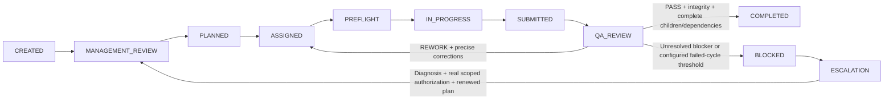

# Task routing and QA contract

The original v0.2 artifact, instruction, dependency and path-integrity checks remain
in agent_hub/legacy.py and are extended by the supported v0.3 Hub in core.py.
The legacy foundation is internal; the supported CLI never exposes a bypass mode.

## Lifecycle

Management review must record analysis; a plan must preserve the original user
criterion and specify an allowed owner, selected registered skills, measurable
criteria, priority, rationale and dependency IDs. Assignment is explicit. Parent
and dependency cycles are rejected. Required dependencies must be complete and
still pass byte/instruction integrity before dispatch and final review.

Dispatch creates a packet and records HANDOFF/DEPARTMENT_HANDOFF. It never invokes
an AI. The selected worker reads its skills and uses recall after this handoff.
Preflight must match the current instruction fingerprint and exactly the selected
skill paths. A separate start record precedes execution and submission. Submission
records authors, artifacts, evidence, limitations and skills used, then queues QA.

Every transition records timestamp, task ID, responsible actor and evidence.
The compatibility `status` field projects phases as QUEUED, DISPATCHED, QA, REWORK,
BLOCKED, COMPLETED or CANCELLED. New reports use `phase` as the authoritative lifecycle.

## Review schema

A review requires `review_reference`, `criteria`, `checks`, `tests` and, when no
executable tests apply, `test_rationale`. Every planned criterion must appear exactly
once with criterion text, verdict and nonempty evidence references. Acceptance
criteria cannot be skipped as not applicable. Every quality check must be assessed:
completeness, functional_correctness, accuracy_evidence, output_quality,
user_instructions, security_permissions, skill_use, source_freshness,
reproducibility, missing_requirements and artifact_integrity.

Rows use PASS, FAIL, BLOCKED or (quality checks only) NOT_APPLICABLE. Failed or blocked
rows require precise correction text; not-applicable rows require a reason. Test
records name the actual command/check, result and reference. PASS is rejected if
any criterion, check or test failed. A contributing author cannot be the independent
reviewer. Structural records cannot authenticate identity or prove a check occurred.

REWORK preserves original findings and returns to the same department owner. A new
dispatch, memory lookup, preflight and start are required for each correction cycle.
Default escalation threshold is three, configurable 1..20 at intake. At threshold,
record diagnosis and actual user authorization with resume; a higher threshold must
exceed failures, and Management must plan/assign again. No automatic reset or PASS.
BLOCKED means a genuine unresolved issue, not simply the first unsuccessful review.

QA-approved outcomes and supplied lessons are saved as operator-reviewed memory,
not automatically certified factual truth. Parent PASS recursively rechecks completed
children. If a completed child changes, restore its reviewed bytes or replace the
parent/child task tree with current work; historic approvals are not rewritten.

## Failure recovery and limits

Pending work, events, selected skills and retries persist across process restarts.
Inspect show/history/report to resume the actual phase. A DISPATCHED record does not
prove a running worker or justify silently replaying external actions. Cancel/replan
stale instruction snapshots. Cancellation does not recursively cancel children; review
those explicitly. Sync retry queues are separate from QA failures and never execute
business actions. Host permissions, actual author/reviewer identity and external
side-effect idempotency remain runtime responsibilities.
